<p align="center">
  
</p>

<h1 align="center">Atrium Desktop</h1>

<p align="center">
  <b>不仅仅是桌面美化。</b><br>
  保留 Windows 的用法，换上一块实时折射的液态玻璃，<br>
  再用同一套设计语言，把任务栏、开始菜单、控制中心、通知和小组件连成一个整体。
</p>

<p align="center">
  <a href="https://github.com/wynter-yaxley/atrium-desktop/releases/latest"><b>下载</b></a>&nbsp;&nbsp;·&nbsp;&nbsp;<a href="#功能"><b>功能</b></a>&nbsp;&nbsp;·&nbsp;&nbsp;<a href="#开始使用"><b>开始使用</b></a>&nbsp;&nbsp;·&nbsp;&nbsp;<a href="README_EN.md"><b>English</b></a>
</p>

<p align="center">
  <a href="https://github.com/wynter-yaxley/atrium-desktop/releases/latest"></a>
  <a href="https://github.com/wynter-yaxley/atrium-desktop/actions/workflows/build.yml"></a>
  
  <a href="LICENSE"></a>
</p>

<p align="center">
  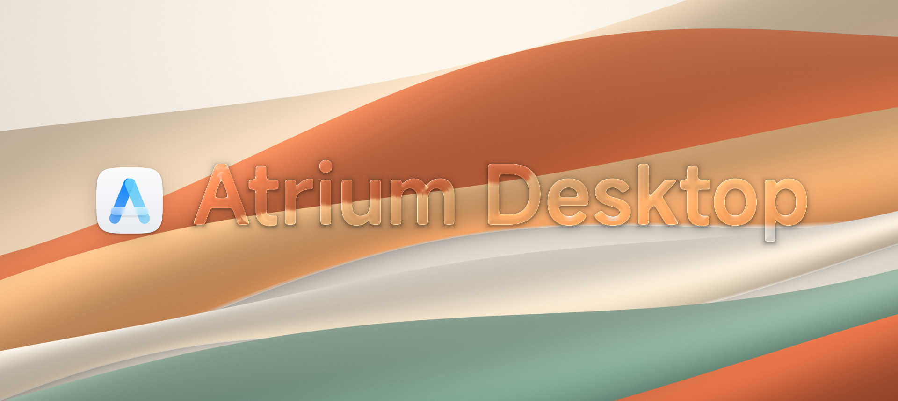
</p>

## 不仅仅是桌面美化

Windows 的桌面是几代设计叠起来的：任务栏、托盘、开始菜单、通知、快捷设置，各有各的圆角、字号和动画。Atrium 把每天看到的这一层重新做了一遍，但没有改变你用 Windows 的方式。

- **用法不变**：固定应用、切换窗口、右键菜单、把文件拖到应用图标上打开，都和原来一样。
- **同一块玻璃**：栏、面板、菜单、通知和小组件用的是同一种材质，实时映出背后的桌面。
- **同一套设计语言**：圆角、间距、字体和动画遵循同一套规则，同一种控件在哪里都是同样的手感。
- **三个独立模块**：任务栏、桌面小组件和台前调度可以分别打开，只用其中一个也行。
- **中英文界面**：设置中心的“系统 → 语言”可选择简体中文、English，或跟随 Windows；栏、面板、菜单、通知、小组件和设置中心一起切换。语言文案在 `locales/` 下，每门语言一个 JSON 文件；没有翻译的词条回退英文。
- **干净**：不向系统进程注入代码，不改系统文件，不装服务，不需要管理员权限。退出后，Windows 自己的任务栏照常回来。

## 功能

### 液态与磨砂

<p align="center">
  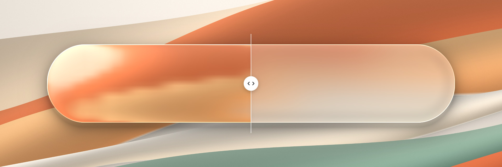
</p>

玻璃会折射背后的画面，边缘带一点高光和色散。喜欢通透，用液态（左）；喜欢安静，用磨砂（右）。透明度、模糊和折射强度也可以在设置中心里自己调。玻璃上的文字会跟着背后的明暗自动换成深色或浅色。

### 任务栏

<p align="center">
  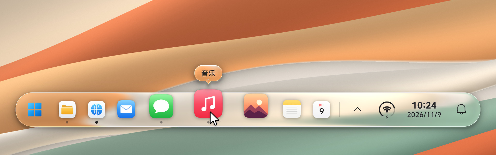
</p>

- 悬浮在屏幕底部的胶囊形玻璃栏。指针划过时，图标像波浪一样放大，停一下会浮出应用名称。
- 指针停在打开的应用上，会显示它每个窗口的实时预览，可以直接切换或关闭。
- 右键图标和 Windows 任务栏一样，列出程序自己的跳转列表：已固定和最近的文件、文件夹、工作区，以及程序提供的任务（如浏览器的新窗口、无痕窗口）；还可以以管理员身份运行、查看属性。设置中心里可以关掉，恢复简单的菜单。
- 固定的应用可以拖动排序；前台应用全屏或最大化时，栏会让开（也可以设成常驻或一直隐藏）。游戏、视频等铺满整个屏幕的应用在前台时，指针碰到底边也不会唤出任务栏，和 Windows 任务栏一样，不会把全屏游戏挤回桌面。打开后，Win + 1…9 可以直接打开栏上的应用。
- 多显示器：在另一块屏幕底边停留即可唤出 Dock；也可固定到主屏、指定屏幕，或在所有屏幕显示任务栏。在设置中心的“显示器”页可选择任务栏应用显示在所有屏幕、主屏和窗口所在屏、或仅窗口所在屏，并调整跨屏停留时间。
- 小组件与台前调度可单独选择桌面显示器。目标屏幕断开时临时回到主屏，重新连接后自动恢复。

### 开始菜单

<table>
  <tr>
    <td width="50%">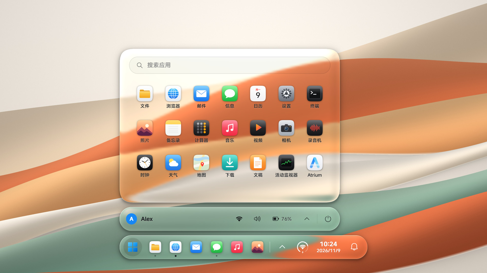</td>
    <td width="50%">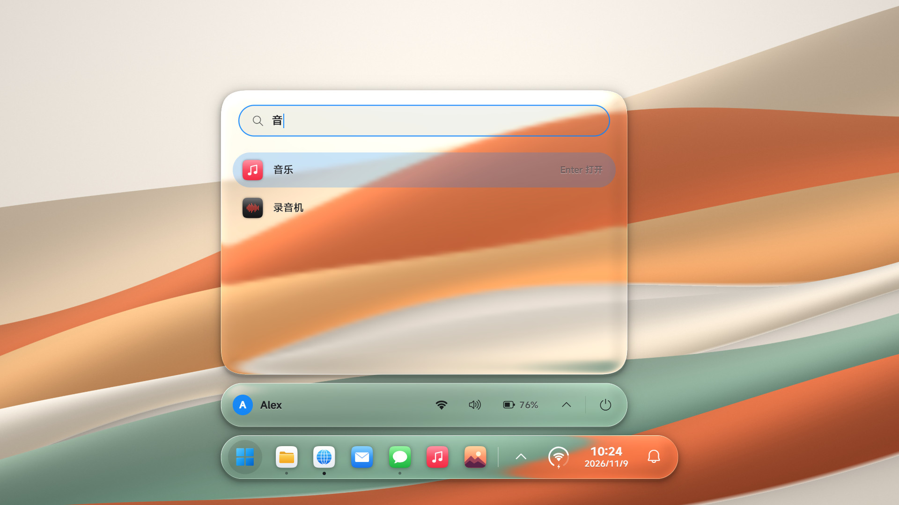</td>
  </tr>
</table>

点栏左侧的 Windows 徽标打开，也可以设成按 Win 键打开。Windows 开始菜单里固定的应用照常在这里；搜索框旁的同步按钮可以随时把 Windows 开始菜单的固定应用、以及“所有应用”里的文件夹连同其中的应用一起同步过来；图标可以拖动换位置，拖到另一个图标上就建成文件夹，可以命名。菜单有小、中、大三档。打开后不用点搜索框，直接打字就能搜索应用和文件夹，也能按拼音首字母搜（wx 找到微信）；“全部应用”按 A–Z 排列，左侧字母条可以快速跳转。右键应用可以以管理员身份运行、打开文件所在的位置，不想看到的应用也可以右键隐藏。下面一条是账户、网络、音量、电量和电源；设置中心里可以选菜单大小，也可以去掉其中的托盘或状态按钮。

### 状态圆环与控制中心

<p align="center">
  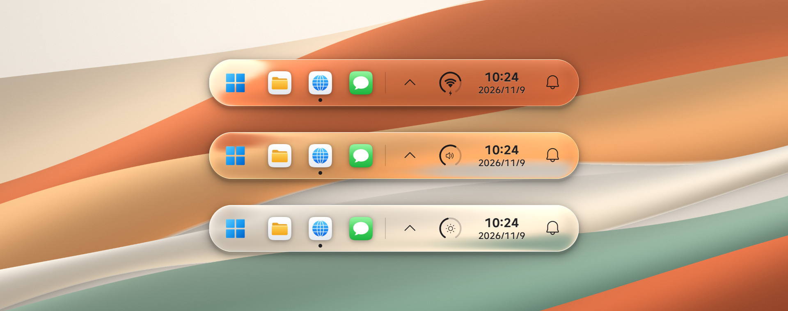
</p>

栏的右侧只有一个圆环，代替一排电池、网络和音量图标。外圈是电量，充电时开口处有一道闪电；中间是 Wi‑Fi。调音量或亮度时，圆环变成对应的刻度，1.5 秒后自己回到电量和 Wi‑Fi。在圆环上滚动滚轮可以直接调音量。习惯 Windows 的样子，也可以换成并排的网络、音量、电池三个图标。

<table>
  <tr>
    <td width="50%">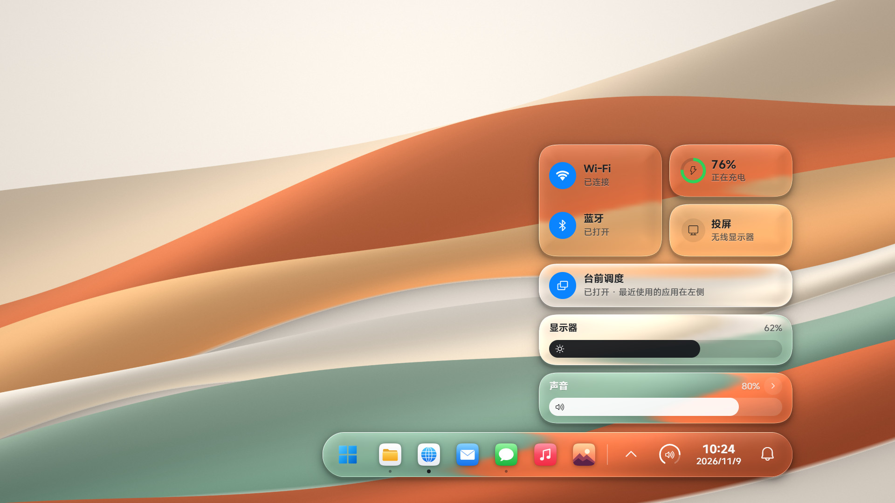</td>
    <td width="50%">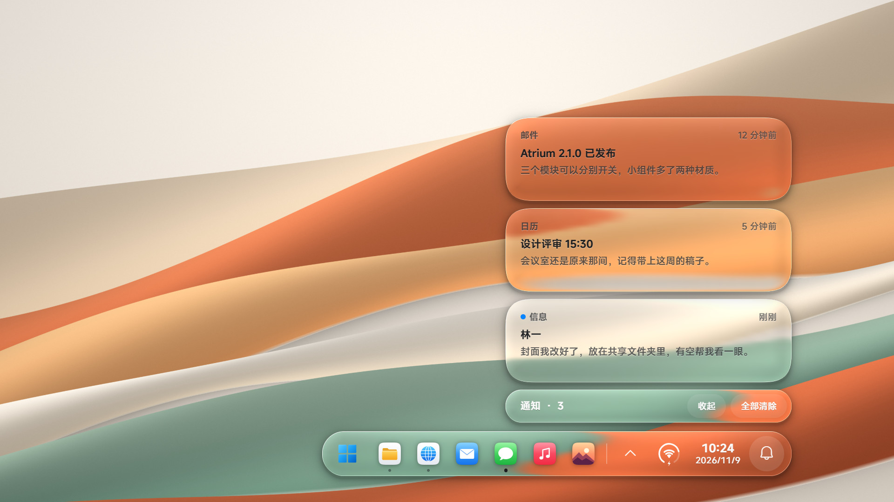</td>
  </tr>
</table>

点圆环打开控制中心：Wi‑Fi、蓝牙、电池、投屏、台前调度、显示器亮度、声音和输出设备，还能分别调各个应用的音量。点铃铛打开通知：新消息叠成一摞，点一下展开成列表。点时钟打开带农历和节日的日历。

设置中心的“通知 → 通知位置”可选择“跟随任务栏”（默认）或“主屏右上角”。右上角模式下，新通知从右侧淡入，已有通知平滑向下让位；通知较多时可滚动查看，点击铃铛打开的通知中心也在主屏右上角展开。

### 桌面小组件

<p align="center">
  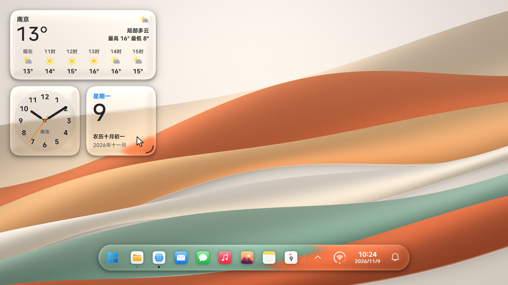
</p>

时钟、数字时钟、日历（带农历）、天气、电池、蓝牙设备、网络、系统监视、备忘录、提醒事项和照片，十一类小组件，三种尺寸。中号的时钟和数字时钟会显示几座城市的时间，右键“更改城市…”可以逐个换成其他城市。拖到哪里都会吸附到网格上；指针移上去，下角会出现一段弧形握把，拖动它就能改变大小。小组件平时在所有窗口下面，按 Win + D 显示桌面时浮到最上。

<p align="center">
  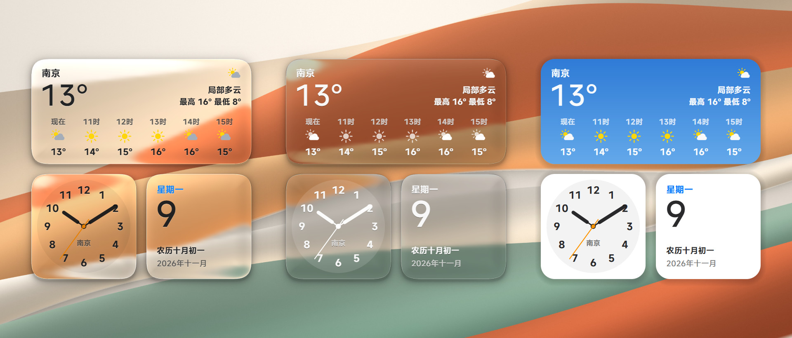
</p>

三种材质可选：**跟随任务栏**的透明玻璃；把玻璃调暗、文字全白的**暮色**；不透明、带原本颜色的**原色**。

### 台前调度

<table>
  <tr>
    <td width="50%">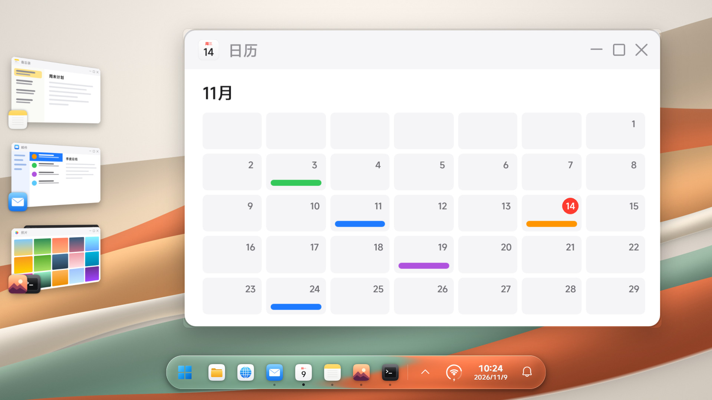</td>
    <td width="50%">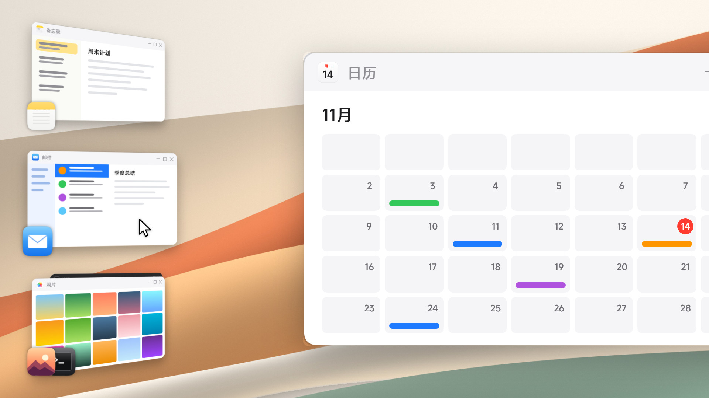</td>
  </tr>
</table>

正在用的应用留在屏幕中间，其余应用收到一侧，窗口画面斜立成一列，每个窗口一张卡片，同一个应用的几个窗口也分开放。指针移上去，窗口转正并稍稍放大；点一下就换到前面，按住 Shift 点按可以把几个应用组成一组。侧边可以一直显示（压在侧边上的窗口来到前台时会自动挪到旁边；窗口最大化时侧边让开，指针碰到屏幕边缘再滑出），也可以只在指针碰到屏幕边缘时滑出。打开“窗口最小化到台前调度”后，最小化前面的应用，它的窗口画面会直接飞进侧边，不再缩到任务栏。设置中心里可以列出不参与台前调度的应用（默认只包含 Windows 系统截图工具），它们的窗口不会被收起，录屏时暂停、停止控件留在屏幕上。关闭台前调度或退出 Atrium 时，所有窗口都会恢复原样。

侧栏的扩展操作：

| 输入 | 行为 |
| --- | --- |
| 滚轮／触控板纵向或横向滚动 | 循环浏览完整侧栏列表，首尾相接；精细滚动累计后换位，不切换前台窗口 |
| 任务栏应用右键 → 打开/添加到当前这一组 | 未被排除的应用始终出现这一行；台前调度开启时已有窗口加入当前组、未启动的应用打开后加入，关闭时只打开应用 |

## 开始使用

1. 从 [Releases](https://github.com/wynter-yaxley/atrium-desktop/releases/latest) 下载 `Atrium-<版本>-win-x64.zip`，解压到任意文件夹。
2. 运行 `WINMAK.exe`。屏幕底部会出现玻璃任务栏，第一次运行时会导入 Windows 任务栏里固定的应用。
3. 双击托盘里的 Atrium 图标，或右键选择“外观设置…”，打开设置中心。材质、尺寸、固定的应用、通知、小组件和三个模块的开关都在这里，“关于”页里可以检查更新。
4. 在托盘图标上右键，选择“退出 Atrium”即可完全退出。设置保存在 `%LOCALAPPDATA%\Atrium`。

系统要求：Windows 10 19041 及以上，推荐 Windows 11。

### 被 Windows 拦截时

Atrium 的发布包没有代码签名，每个新版本的文件在 Windows 那里都还没有信誉。

- **SmartScreen 提示“Windows 已保护你的电脑”**：点“更多信息” › “仍要运行”。
- **提示“应用程序控制策略已阻止此文件”**（运行时出现，或更新时显示“更新未安装”）：是智能应用控制或单位的应用控制策略拦下了新文件。更新会自动恢复旧版本，不会丢设置。在 PowerShell 里运行 `(Get-MpComputerStatus).SmartAppControlState`：
  - 结果是 `On`：可以在 Windows 安全中心 › 应用和浏览器控制 › 智能应用控制里把它关闭。注意，在部分 Windows 版本上，关闭后不重装系统就无法再打开。
  - 结果是 `Off` 但仍被拦截：多半是单位的策略，请联系管理员放行 Atrium 所在的目录。

## 当前状态

| | |
| :--- | :--- |
| 可以日常使用 | 任务栏、开始菜单、控制中心、日历、托盘、通知、桌面小组件、台前调度、设置中心 |
| 实验功能 | 把 Windows 通知显示为 Atrium 卡片；微信和飞书消息 |
| 还没有验证 | 多显示器、HDR、高刷新率、睡眠唤醒、稳定版 Windows 11 |
| 已知限制 | 使用 DXGI 桌面复制的录屏和远程控制软件（UU 远程、ToDesk、向日葵等）默认看不到 Atrium，可在“系统”里打开“远程控制兼容”（玻璃改为映出壁纸）；双显卡笔记本第一次运行后需要重启一次 Atrium |

## 构建

需要 .NET 10 SDK，以及带 C++ 工作负载和 Windows SDK 的 Visual Studio 或 Build Tools（CMake 3.25+）。

```powershell
./tools/build.ps1          # 输出到 dist/Atrium，加 -Zip 同时打包
```

核心是 C++20（Win32、Direct3D 11、DirectComposition），设置中心是 WinUI 3。设计规范见 [docs/DESIGN.md](docs/DESIGN.md)。

## 参与贡献

最有价值的是设计上的意见，以及在不同硬件和系统上的使用反馈。详见 [CONTRIBUTING.md](CONTRIBUTING.md)。

## 许可证

[MIT](LICENSE)。视觉灵感来自 Apple 的 Liquid Glass；本项目与 Apple、Microsoft 无关。

<sub>本页配图按 Atrium 的真实尺寸和材质参数离线渲染，应用图标为原创的示意图形，通知内容为虚构。</sub>
